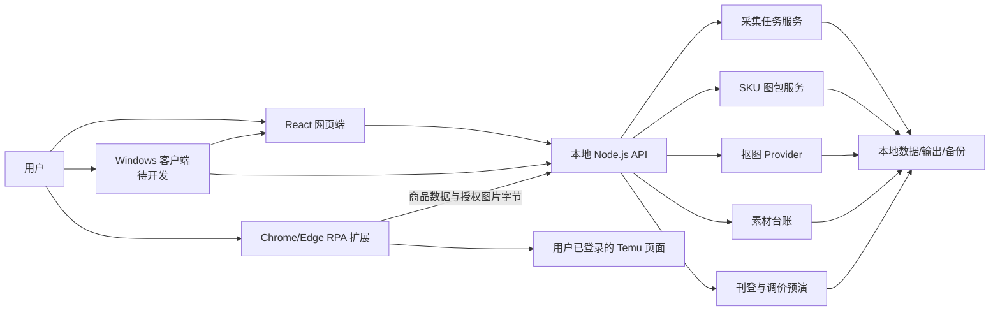

# 跨境图片 RPA：网页端与 Windows 客户端开发状态文档

> 2026-10-20 更新：此文档保留 2026-10-19 状态快照。Windows 客户端壳、安装包、扩展配对及模板副本回填现已实现，最新进度请阅读 [implementation-progress.md](./implementation-progress.md)。

> 文档版本：1.0  
> 状态基线：2026-10-19  
> Temu 深采扩展版本：0.4.0  
> 项目目录：`D:\000code\crossborder-image-agent-New-`

## 1. 文档目的

本文档用于统一说明本软件的产品形态、RPA 功能范围、当前完成进度、组件边界、数据流、接口、验收状态和后续开发顺序。

本软件最终交付形态明确分为两端：

1. **网页端**：提供任务配置、采集管理、图片处理、素材管理、结果查看和人工确认界面。
2. **Windows 客户端**：提供可双击启动的桌面程序，负责本地服务生命周期、文件系统、模型环境、日志和桌面化交付。

Temu 浏览器扩展属于 **RPA 浏览器执行器**，它配合网页端和本地服务工作，但不等同于 Windows 客户端。

## 2. 当前结论

当前项目已进入以下阶段：

> **网页核心功能与本地 RPA 服务已经完成，Temu 扩展 0.4.0 的代码已经完成；目前处于“真实 Temu 页面验收 + Windows 客户端壳开发前”的阶段。**

当前可实际使用的形态是：

- React 网页端：`http://127.0.0.1:5173`
- Node.js 本地后端：`http://127.0.0.1:4000`
- Chrome/Edge Temu 深采扩展：`browser-extension/temu-deep-collector`
- Windows 双击脚本：启动、关闭、检查状态

尚未完成的产品形态是：

- 独立 Windows 桌面窗口
- Windows 安装包与自动升级
- 客户端单实例、托盘、日志管理和崩溃恢复
- 真实店铺官方发布适配器

## 3. 产品与系统边界

### 3.1 网页端

网页端是主要业务操作界面，当前由 React、React Router、Vite 和 Tailwind CSS 构成。

网页端负责：

- 商品与 SKU 任务管理
- 表格和文件夹导入
- 采集任务配置与运行
- SKU 图包规则配置
- 图片角色、命名和压缩配置
- 抠图 Provider 选择
- 素材台账管理
- 刊登草稿预演和调价预览
- 健康检查、清理、快照和验收报告

网页端不直接保存店铺账号，不直接绕过浏览器登录，不直接执行验证码处理。

### 3.2 Windows 客户端

Windows 客户端是最终要补齐的桌面交付层。当前仓库还没有 Electron、Tauri、WebView2 或其他原生桌面壳。

目前只有以下桌面辅助能力：

- `启动小程序.bat`：检查 Node/npm/依赖和端口，启动前后端并打开浏览器。
- `关闭小程序.bat`：停止 4000 和 5173 端口对应进程。
- `检查小程序状态.bat`：检查网页端和后端是否存活。

因此，当前状态应描述为：

> **支持 Windows 双击启动，但尚未形成独立 Windows 客户端。**

建议第一版客户端采用 Electron，共用现有 React 页面和 Node.js 服务，避免重写业务层。客户端应负责：

- 单实例运行
- 自动选择空闲本地端口
- 启动和关闭本地后端
- 内嵌现有网页界面
- 本地文件夹选择与拖放
- 查看运行日志和错误日志
- 检查 Sharp、SQLite、rembg 和浏览器扩展状态
- 管理数据目录、输出目录、备份和清理
- 打包成可安装或便携版 Windows 程序

### 3.3 浏览器 RPA 执行器

Temu 扩展是 Chrome/Edge Manifest V3 扩展，运行在用户自己的浏览器登录会话中。

它负责：

- 从当前列表页识别商品链接
- 从当前商品详情页采集数据
- 读取浏览器已经渲染出的图片信息
- 低频逐页自动采集
- 遇到验证码时停止并保留断点
- 经用户授权后下载图片字节并回传本机

它不负责：

- 绕过验证码
- 伪造浏览器指纹
- 破解登录或访问控制
- 导出 Cookie
- 无限制并发访问 Temu
- 真实发布商品或修改线上价格

## 4. 总体架构



### 4.1 当前技术栈

| 层级 | 当前技术 | 状态 |
| --- | --- | --- |
| 网页界面 | React 18、React Router、Vite、Tailwind CSS | 已完成并运行 |
| 本地 API | Node.js、Express | 已完成并运行 |
| 图片处理 | Sharp | 已完成 |
| 本地数据 | JSON/SQLite 兼容存储 | 已完成 |
| 表格读取 | CSV、TSV、TXT、XLSX | 已完成 |
| 压缩包 | Archiver、AdmZip | 已完成 |
| 浏览器 RPA | Chrome/Edge Manifest V3 | 代码完成，待实站验收 |
| 本地 AI 抠图 | rembg + ONNX Runtime | Provider 已完成，当前机器环境待安装 |
| Windows 原生壳 | 建议 Electron | 未开始 |
| 真实店铺接口 | 平台官方 API | 未接入 |

## 5. RPA 功能总表

状态定义：

- **已完成**：代码和本地自动化测试均已完成。
- **代码完成，待实站验收**：本地契约已完成，但需要用户登录真实站点验证页面结构和平台行为。
- **环境待就绪**：代码已完成，但当前机器缺少运行依赖或模型。
- **未接入**：尚未实现，不能作为已完成功能宣传。

| 模块 | 功能 | 状态 | 说明 |
| --- | --- | --- | --- |
| 普通采集 | CSV/XLSX 导入 | 已完成 | 安全读取，不执行表格公式 |
| 普通采集 | 粘贴商品链接或图片链接 | 已完成 | 校验 HTTP/HTTPS 地址 |
| 普通采集 | 标题、销量、图片提取 | 已完成 | 支持公开页面和结构化数据 |
| 普通采集 | 按销量过滤 | 已完成 | 未识别销量时保守跳过或记录原因 |
| 普通采集 | 分批执行、暂停和继续 | 已完成 | 支持批次限制和断点恢复 |
| 普通采集 | 防丢备份 | 已完成 | `manifest.json` 和 `manifest.backup.json` |
| 普通采集 | 额外页面等待 | 已完成 | 可设置等待时间 |
| 普通采集 | 失败继续、失败明细 | 已完成 | 单项失败不阻断后续项目 |
| 普通采集 | ZIP 导出 | 已完成 | 图片和 manifest 一起导出 |
| 原图适配 | Amazon 原图地址还原 | 已完成 | 移除常见缩放后缀 |
| 原图适配 | Pinterest 原图地址还原 | 已完成 | 替换常见尺寸路径 |
| 原图适配 | 自定义地址替换规则 | 已完成 | 支持前缀和文本替换 |
| Temu 深采 | 手工采集当前商品 | 代码完成，待实站验收 | 推荐的低风控模式 |
| Temu 深采 | 列表商品链接识别 | 代码完成，待实站验收 | 识别常见 Temu 商品链接 |
| Temu 深采 | 单标签低频自动采集 | 代码完成，待实站验收 | 复用一个标签页，降低访问压力 |
| Temu 深采 | 验证码检测和暂停 | 代码完成，待实站验收 | 不绕过验证码，人工完成后继续 |
| Temu 深采 | 可见图和懒加载图 | 代码完成，待实站验收 | `img`、`data-*`、`srcset` |
| Temu 深采 | CSS 背景图片 | 代码完成，待实站验收 | 提取 `background-image` |
| Temu 深采 | JSON-LD/页面 JSON | 代码完成，待实站验收 | 有深度和节点数量限制 |
| Temu 深采 | 脚本隐藏图片地址 | 代码完成，待实站验收 | 有脚本文本扫描大小限制 |
| Temu 深采 | 变种图片与来源统计 | 代码完成，待实站验收 | 保留 variant id、名称和图片 |
| Temu 深采 | 登录态图片回传 | 代码完成，待实站验收 | 用户授权图片域名；只传图片，不导出 Cookie |
| SKU 图包 | 按 SKU 文件夹分组 | 已完成 | 支持整目录导入 |
| SKU 图包 | 自然、上传、随机顺序 | 已完成 | 随机顺序可用固定种子复现 |
| SKU 图包 | 手工拖拽排序 | 已完成 | 前端排序，后端按 `manualOrder` 执行 |
| SKU 图包 | 图片角色识别 | 已完成 | 文件名、手工覆盖、内容辅助识别 |
| SKU 图包 | 主图、附图、方图等目录 | 已完成 | 支持七类角色 |
| SKU 图包 | 命名占位符 | 已完成 | SKU、SPU、规格、变种 SKU、标题、角色、序号 |
| SKU 图包 | 随机文件名 | 已完成 | 同一输入和种子可复现 |
| SKU 图包 | 保留原图和预处理图 | 已完成 | 分目录保存 |
| SKU 图包 | 自动生成方图 | 已完成 | 使用首张有效主图补边 |
| SKU 图包 | 固定画质压缩 | 已完成 | JPEG、PNG、WebP |
| SKU 图包 | 目标 KB 自适应压缩 | 已完成 | 逐步调低质量和尺寸，记录是否达标 |
| SKU 图包 | 感知去重 | 已完成 | 使用图像感知指纹和汉明距离 |
| SKU 图包 | 图像内容辅助角色识别 | 已完成 | 强特征色块图和极端比例细节图；记录依据和置信度 |
| 抠图 | Sharp 本地抠图 | 已完成 | 适合浅色或纯色背景 |
| 抠图 | rembg 本地 AI 抠图 | 环境待就绪 | Provider、蒙版、裁切和 Sharp 回退已完成 |
| 抠图 | 外部高清抠图 API | 已完成，可选配置 | 只有显式确认费用后调用 |
| 抠图 | Image2 抠图 | 已完成，可选配置 | 实验能力，只有显式确认费用后调用 |
| 素材管理 | 素材台账 | 已完成 | SKU、平台、用途、素材 ID、文件名和备注 |
| 刊登辅助 | 多平台字段预检 | 已完成 | 只生成草稿，不上传店铺 |
| 刊登辅助 | CSV 草稿导出 | 已完成 | 不宣称是平台最新官方模板 |
| 调价辅助 | 多轮调价预览 | 已完成 | 百分比、固定金额和尾数处理 |
| 店铺操作 | 真实商品发布 | 未接入 | 需要指定平台官方应用、沙箱和授权 |
| 店铺操作 | 线上自动改价 | 未接入 | 当前只做本地预览 |
| 桌面端 | 双击启动/关闭/状态检查 | 已完成 | BAT 脚本形式 |
| 桌面端 | 独立 Windows 客户端 | 未开始 | 建议下一阶段使用 Electron |

## 6. 当前开发阶段

### 阶段 0：Clean-room 范围确认

状态：**已完成**

- 已区分目标软件静态功能证据和远程运行行为。
- 没有复制目标应用的混淆代码、密钥、账号数据或私有服务。
- 已确定图片采集、图包处理、刊登预演和调价预览的自主实现范围。

### 阶段 1：网页端与本地服务基础

状态：**已完成**

- React 路由、工作台页面和任务页面已经建立。
- Express API、上传目录、输出目录和数据存储已经建立。
- Windows 启动、关闭和状态检查脚本已经建立。
- 当前后端和网页端健康检查均返回 HTTP 200。

### 阶段 2：普通采集与批量下载

状态：**已完成**

- 已完成表格导入、链接导入、销量过滤、断点、备份、重试、下载和 ZIP。
- 已完成私有地址、非标准端口和危险 URL 拦截。
- 已完成 Amazon、Pinterest 原图适配和自定义地址替换。

### 阶段 3：SKU 图包处理

状态：**已完成**

- 已完成 SKU 分组、七类角色、命名规则、随机命名、原图、预处理图和方图。
- 已完成拖拽排序、目标 KB 压缩、感知去重和图像内容辅助识别。
- 处理记录、跳过原因、压缩尝试和失败原因均写入 manifest。

### 阶段 4：Temu 浏览器 RPA

状态：**代码完成，待实站验收**

- 扩展当前版本为 0.4.0。
- 已完成手工模式、保守自动模式、冷却、断点和验证码暂停。
- 已完成隐藏图、结构化数据、变种图和登录态图片回传。
- 尚未在当前开发轮次中使用用户真实 Temu 页面完成端到端验收。

### 阶段 5：本地 AI 抠图

状态：**Provider 完成，当前机器环境待就绪**

- rembg 本地命令 Provider 已完成。
- 支持透明主体、Alpha 蒙版、主体边界框和失败回退。
- 提供隔离环境安装脚本 `backend/scripts/setup-rembg.ps1`。
- 当前机器只有 Python 3.14；当前 rembg 版本需要 Python 3.11–3.13，因此界面会正确显示为不可用。
- 模型权重具有独立许可，安装前必须人工确认所选模型的商用和分发许可。

### 阶段 6：Windows 客户端

状态：**未开始原生壳开发**

现有 BAT 启动器只解决开发环境启动，不等于可交付桌面客户端。下一阶段需要：

1. 建立 Electron 主进程。
2. 打包 React 生产页面。
3. 管理本地后端子进程和端口。
4. 建立单实例锁和退出清理。
5. 建立用户数据目录和日志目录。
6. 处理 Sharp、better-sqlite3 等原生依赖打包。
7. 增加模型与扩展状态页。
8. 生成 Windows 安装包和便携版。

### 阶段 7：真实平台适配器

状态：**未接入**

只有满足以下条件后才能开始：

- 明确目标平台和站点。
- 用户提供或创建官方开发者应用。
- 取得官方 API 文档和沙箱。
- 明确 OAuth、Token 轮换和权限范围。
- 先完成草稿创建或沙箱发布，不直接进入生产店铺。
- 对每次真实写入保留人工确认和审计日志。

## 7. Temu RPA 详细流程

### 7.1 推荐手工模式

1. 用户正常登录 Temu。
2. 用户手工打开商品详情页并等待页面加载。
3. 用户点击“采集当前商品”。
4. 扩展读取标题、销量、图片、变种和来源统计。
5. 用户继续浏览下一个商品并重复采集。
6. 用户点击“生成下载任务”。
7. 如果开启登录态图片回传，浏览器按实际图片域名请求权限。
8. 扩展下载图片字节并提交给本地后端。
9. 后端验证图片格式、大小、任务归属和来源 URL。
10. 本地任务继续处理未由浏览器成功回传的地址。

### 7.2 保守自动模式

1. 用户打开 Temu 列表页并正常滚动加载商品。
2. 扩展识别商品链接。
3. 扩展复用一个专用标签页逐项打开商品。
4. 每个商品等待页面稳定后提取。
5. 商品之间设置固定间隔。
6. 每轮默认处理 3 个商品后冷却 60 秒。
7. 出现验证码或异常访问提示时立即暂停。
8. 用户完成人工验证后手工继续。

自动模式不会承诺不触发风控。风控概率由平台、账号、网络、访问频率和页面行为共同决定。

### 7.3 扩展状态机

```text
idle
  ├─ collect-current -> manual
  │    └─ finish-manual -> uploading -> completed
  └─ prepare -> prepared -> running
                         ├─ cooldown -> running
                         ├─ challenge -> running
                         ├─ pausing -> paused -> running
                         ├─ completed
                         └─ failed
```

扩展状态保存在 `chrome.storage.local`，浏览器服务工作线程暂停后仍可恢复关键进度。

## 8. SKU 图包处理详细流程

1. 网页端选择包含多个 SKU 子目录的根文件夹。
2. 浏览器上传图片和每张图片的相对路径。
3. 后端剥离共同根目录并按第一级目录识别 SKU。
4. 按自然、上传、随机或手工顺序排列。
5. 按以下优先级确定角色：
   - 手工角色覆盖
   - 文件名提示
   - 图像内容辅助识别
   - 第一张主图、其余附图的兜底规则
6. 可选计算感知指纹并跳过重复图片。
7. 可选保留原图和生成预处理图。
8. 可选执行 Sharp、rembg、外部 API 或 Image2 抠图。
9. 执行尺寸限制、格式转换和目标 KB 自适应压缩。
10. 根据占位符生成文件名并按角色写入目录。
11. 可选从首张有效主图额外生成方图。
12. 生成 ZIP 和 manifest。

角色目录包括：

- `main`：主图
- `additional`：附图
- `square`：方形图
- `swatch`：色块图
- `detail`：细节图
- `variant`：变种图
- `general`：通用图

## 9. 本地 API 清单

以下是本轮 RPA 工作台的主要接口：

| 方法 | 接口 | 用途 |
| --- | --- | --- |
| GET | `/api/health` | 后端健康检查 |
| GET | `/api/workbench/overview` | 工作台能力与边界 |
| GET | `/api/workbench/jobs` | 工作台任务列表 |
| POST | `/api/workbench/collection-plans` | 创建链接采集计划 |
| POST | `/api/workbench/collection-jobs` | 从表格创建采集任务 |
| POST | `/api/workbench/collection-jobs/rows` | 从网页或扩展数据创建采集任务 |
| GET | `/api/workbench/collection-jobs/:jobId` | 读取采集任务 |
| POST | `/api/workbench/collection-jobs/:jobId/run` | 运行或继续采集任务 |
| POST | `/api/workbench/collection-jobs/:jobId/browser-images` | 导入浏览器授权会话下载的图片 |
| POST | `/api/workbench/sku-packs` | 处理 SKU 文件夹图包 |
| POST | `/api/workbench/sku-metadata-imports` | 导入 SKU 替换字段 |
| POST | `/api/workbench/image-packs` | 普通图片包处理 |
| GET | `/api/workbench/materials` | 查询素材台账 |
| POST | `/api/workbench/materials/import` | 导入素材记录 |
| PATCH | `/api/workbench/materials/:recordId` | 更新素材记录 |
| GET | `/api/workbench/materials/export.csv` | 导出素材 CSV |
| POST | `/api/workbench/template-inspections` | 识别 XLSX 表头和字段 |
| POST | `/api/workbench/listing-dry-runs` | 刊登字段预检和草稿生成 |
| POST | `/api/workbench/pricing-previews` | 调价预览 |
| GET | `/api/matting/config` | 查询抠图 Provider 状态 |

## 10. 数据与文件结构

### 10.1 运行目录

| 目录 | 用途 |
| --- | --- |
| `uploads/` | 上传暂存和源文件 |
| `outputs/` | 图包、采集图片、ZIP 和报告 |
| `backups/` | 快照和备份 |
| `backend/data/` | 本地业务数据 |
| `.vision-tmp/` | 抠图和视觉处理中间文件 |

### 10.2 采集任务 manifest

采集任务至少记录：

- 任务 ID、名称、状态和时间
- 采集模式和参数
- 输入商品数量
- 每个商品的 SKU、标题、销量和商品链接
- 图片原地址、解析后地址、下载状态和本地文件
- 变种图片和提取来源统计
- 尝试次数、错误码和错误信息
- 成功、失败、跳过、待处理和已下载统计
- manifest、backup 和 ZIP 地址

### 10.3 SKU 图包 manifest

SKU 图包至少记录：

- 排序、命名、格式、质量和目标 KB 配置
- 每张图片的源相对路径
- 角色、角色来源、识别依据和置信度
- 重复图对应关系和感知距离
- 抠图 Provider、模型、回退和边缘警告
- 输出尺寸、字节数、最终质量和压缩尝试次数
- 目标体积是否达标
- 成功、失败、重复跳过、自动方图和抠图统计

## 11. 安全与合规边界

### 11.1 地址安全

- 只接受 HTTP/HTTPS。
- 拒绝 URL 中的用户名和密码。
- 拒绝本机、局域网、链路本地和保留地址。
- 拒绝非标准远程端口。
- 限制页面和图片最大响应大小。
- 限制重定向次数和请求超时。

### 11.2 浏览器权限

- Temu 页面权限是固定站点权限。
- 图片 CDN 权限在用户点击生成任务时按域名请求。
- 扩展不读取或上传 Cookie 字符串。
- 登录态图片只回传到 `127.0.0.1:4000`。

### 11.3 外部费用

- Sharp 和已经安装的本地 rembg 推理不产生第三方调用费用。
- 外部抠图 API 和 Image2 必须逐任务确认可能产生的费用。
- 配置 API Key 不代表允许自动调用。

### 11.4 平台操作

- 当前没有真实店铺上传按钮。
- 当前没有线上自动改价。
- 刊登结果是预检草稿，不是假装成功的发布结果。
- 任何真实平台写入必须使用官方授权接口和沙箱。

## 12. 测试与验收基线

### 12.1 当前自动化结果

- 本轮新增和相关定向测试：`40/40` 通过。
- 后端全量测试：`471/475` 通过。
- 前端生产构建：通过。
- 扩展 JavaScript 和 manifest 静态检查：通过。
- rembg PowerShell 安装脚本语法检查：通过。
- 当前运行中的后端健康检查：HTTP 200。
- 当前运行中的网页端检查：HTTP 200。

### 12.2 当前 4 个全量测试失败

当前剩余失败集中在旧功能：

- Windows 跨盘临时绝对路径被错误拼接到项目根目录。
- OpenAI 主体合成测试受上述临时路径问题影响而回退。

这些失败不属于本轮 Temu、SKU 图包、登录态图片回传或 rembg Provider 的定向测试范围，但发布前仍应单独修复。

### 12.3 Temu 实站验收清单

建议先使用 3 个商品进行小范围验收：

1. 普通单变种商品。
2. 多颜色或多规格商品。
3. 图片数量较多且包含详情图的商品。

每个商品检查：

- 标题是否正确。
- 销量是否正确或明确为空。
- 页面可见图片是否完整。
- 轮播懒加载图片是否完整。
- 变种图片是否被记录。
- 来源统计是否合理。
- 浏览器权限提示是否只包含图片域名。
- 回传图片是否能在本地任务中打开。
- 拒绝域名权限后是否仍保留图片链接。
- 验证码出现时是否停止而不是继续请求。

验收通过前，Temu 模块状态保持“代码完成，待实站验收”。

## 13. Windows 客户端建议架构

### 13.1 第一版目标

第一版客户端不是重写业务，而是安全地封装现有网页端和本地服务：

```text
Electron Main Process
  ├─ SingleInstanceLock
  ├─ BackendProcessManager
  ├─ PortAndHealthManager
  ├─ LocalPathManager
  ├─ LogManager
  ├─ UpdateManager
  └─ BrowserWindow -> 现有 React 页面
```

### 13.2 客户端必须满足

- 双击即可启动，不要求用户手工开两个命令行窗口。
- 同一时间只运行一个实例。
- 后端异常退出时给出明确提示并允许重启。
- 客户端退出时只关闭自己启动的后端进程。
- 数据、日志、模型和缓存使用独立目录。
- 不覆盖用户选择的原图目录。
- 支持便携版和安装版至少一种交付方式。
- 打包后验证 Sharp 和 better-sqlite3 原生模块。
- 不把 `.env`、API Key、店铺数据、浏览器状态或真实业务数据库打入发布包。

### 13.3 网页版与客户端共用规则

- 共用 React 页面和 API 契约。
- 共用图片处理、采集、台账、预演和报告服务。
- 共用测试，不维护两套业务代码。
- 客户端只增加桌面能力，不复制核心业务逻辑。

## 14. 下一阶段开发顺序

### P0：真实 Temu 小样本验收

- 在 Edge 扩展管理页重新加载 0.4.0。
- 使用 3 个商品验证隐藏图、变种图和登录态图片回传。
- 保存每个失败页面的 URL 类型、页面状态和扩展错误，不保存账号、Cookie 或验证码截图。
- 根据实站结构补选择器或 JSON 路径。

### P0：修复 Windows 跨盘临时路径

- 统一识别 Windows 绝对路径。
- 禁止把 `C:\...` 再拼接到 `D:\项目目录`。
- 恢复当前 4 个全量失败测试。

### P1：建立 Windows 客户端壳

- 建立 Electron workspace。
- 实现单实例、后端进程、端口、日志和窗口生命周期。
- 共用前端生产构建。
- 生成第一版 Windows 测试包。

### P1：本地 AI 环境验收

- 安装 Python 3.11–3.13 中的一个受支持版本。
- 人工确认模型权重许可。
- 运行 `backend/scripts/setup-rembg.ps1`。
- 使用白底、复杂背景、毛发/透明边缘各一张图片验收。

### P2：模板回填

- 使用用户提供的最新官方 XLSX 模板。
- 在副本上完成字段映射和回填。
- 保留原工作簿结构、样式、公式和必填校验。

### P3：官方平台适配器

- 用户先选定具体平台。
- 接入官方沙箱或测试店铺。
- 第一阶段只创建草稿，不直接发布。
- 完成人工确认、幂等、失败重试和审计后再讨论生产写入。

## 15. 开发完成定义

### 网页端完成定义

- 页面可以独立打开并完成主要 RPA 配置。
- 后端异常能显示明确错误。
- 刷新页面不会破坏已经落盘的任务。
- 关键功能有自动化测试和 manifest 证据。

### Windows 客户端完成定义

- 在未安装项目开发依赖的普通 Windows 机器上可以安装或解压运行。
- 双击一个程序即可打开完整界面。
- 不弹出多余终端窗口。
- 可以启动、停止和恢复本地服务。
- 可以找到数据、日志、输出和备份目录。
- 卸载不会删除用户业务数据，除非用户明确选择。

### Temu RPA 完成定义

- 至少 3 种商品结构通过实站验收。
- 多图和变种图有明确数量对比。
- 验证码会暂停。
- 中断后可以恢复。
- 登录态图片回传不泄漏 Cookie。
- 失败项有 URL、错误码和重试状态。

### 真实发布完成定义

- 使用官方 API 和官方授权。
- 先通过沙箱或测试店铺。
- 默认只创建草稿。
- 每次真实写入需要明确确认。
- 具备幂等键、审计日志、失败重试和回滚方案。

## 16. 关键文件索引

| 文件 | 用途 |
| --- | --- |
| `frontend/src/App.jsx` | 网页端路由入口 |
| `frontend/src/pages/CollectionWorkbenchPage.jsx` | 采集工作台 |
| `frontend/src/pages/SkuPackPage.jsx` | SKU 图包页面 |
| `frontend/src/pages/MaterialsWorkbenchPage.jsx` | 素材台账页面 |
| `backend/src/routes/workbenchRoutes.js` | RPA 工作台接口 |
| `backend/src/services/collectionJobService.js` | 采集、断点、下载和浏览器图片导入 |
| `backend/src/services/skuPackService.js` | SKU 图包处理 |
| `backend/src/providers/matting/rembgMattingProvider.js` | 本地 AI 抠图 Provider |
| `browser-extension/temu-deep-collector/background.js` | Temu RPA 主逻辑 |
| `browser-extension/temu-deep-collector/popup.js` | 扩展操作界面逻辑 |
| `browser-extension/temu-deep-collector/manifest.json` | 扩展权限和版本 |
| `backend/scripts/setup-rembg.ps1` | rembg 隔离环境安装 |
| `启动小程序.bat` | 当前 Windows 双击启动器 |
| `关闭小程序.bat` | 当前 Windows 停止脚本 |
| `检查小程序状态.bat` | 当前 Windows 健康检查脚本 |

## 17. 维护要求

后续每次开发完成后，应同步更新本文件中的：

- 文档版本和状态基线日期
- 功能状态总表
- 当前开发阶段
- 测试通过数量
- 已知失败与风险
- 下一阶段优先级
- 扩展版本和客户端版本

不得把“代码存在”“本地模拟通过”“真实站点通过”“真实店铺发布成功”混写成同一种完成状态。
