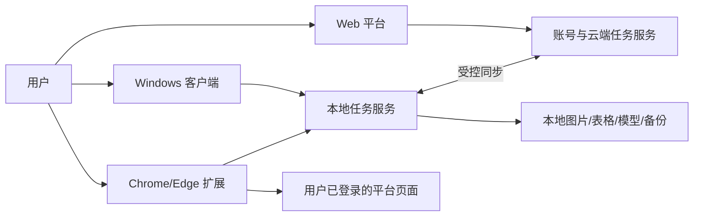

# 星芽类跨境图片运营系统开发需求文档

> 文档版本：1.0  
> 基线日期：2026-10-19  
> 产品形态：Web 平台 + Windows 客户端 + 浏览器 RPA 扩展  
> 文档状态：首版需求基线，可用于原型、任务拆分、开发和验收

> 实施更新（2026-10-20）：0.9.0 完成成员隔离、归属分配、技术支持角色、权限撤销和分页恢复；0.10.0 继续迁移核心页面中英文。下文“当前状态”和第 9 节保留历史基线；68 项最新实现和实际验收以 [implementation-progress.md](./implementation-progress.md) 为准，未实测项不标记为完成。

## 1. 文档目的

本文档定义一个独立实现的跨境商品图片与运营工具，整理目标产品的网页端结构、客户端静态功能、当前项目已有能力、尚未实现范围、开发顺序和验收标准。

本文档是“要开发什么”的需求基线；当前代码的逐项实现状态和接口明细，参见 [rpa-web-desktop-development-status.md](./rpa-web-desktop-development-status.md)。

### 1.1 信息来源标记

| 标记 | 含义 |
| --- | --- |
| `WEB-OBS` | 2026-10-19 对 `https://xingyaai.cn/homePage` 及其公开静态前端资源的只读观察 |
| `CLIENT-OBS` | 已安装客户端发布制品的 REA 静态分析结论 |
| `CURRENT` | 当前仓库代码、测试、页面或脚本可以确认的行为 |
| `DESIGN` | 为形成可维护产品而制定的自主设计，不表示目标软件一定采用相同实现 |
| `UNKNOWN` | 仅靠公开页面或静态制品不能确认，必须在授权环境中联调或由产品负责人决定 |

### 1.2 Clean-room 边界

本项目只复刻可观察的产品工作流和通用交互，不复制目标软件的混淆源代码、品牌素材、私有接口签名、密钥、会员数据、账号数据或服务端实现。

以下行为不在需求范围内：

- 绕过验证码、登录、风控、访问控制或平台限流。
- 导出浏览器 Cookie、令牌或其他登录凭据。
- 未经授权抓取、上传、发布或修改店铺数据。
- 猜测并调用目标产品私有接口。
- 宣称静态制品中出现的远程功能已经完成实站验证。

## 2. 产品定义

产品由三个用户可见组件和一个共享服务层组成：

1. **Web 平台**：负责账号、团队、任务、模板、商品、云端结果和运营管理。
2. **Windows 客户端**：负责本地文件、本地图片处理、本地模型、批量任务、日志和桌面交付。
3. **浏览器 RPA 扩展**：在用户自己的已登录浏览器中，执行低频、可暂停、可审计的网页采集或授权操作。
4. **共享任务服务**：统一任务模型、规则、素材台账、结果清单、同步和审计。



### 2.1 产品目标

- 将“采集—下载—抠图—图包整理—素材映射—刊登草稿—调价预览”串成可追踪工作流。
- 大批量任务支持断点恢复、防丢备份、失败继续和明确结果汇总。
- 网页端和客户端共用任务定义，不重复实现核心规则。
- 本地图片和账号敏感信息默认留在用户设备。
- 对验证码、登录失效、平台限流和人工确认设置明确暂停点。
- 每个自动化结果都能追溯输入、规则、输出、失败原因和执行时间。

### 2.2 非目标

- 第一版不追求目标官网所有 AI 生图、会员、钱包和支付能力一比一等价。
- 第一版不接入真实店铺自动发布和线上自动改价。
- 第一版不建立规避平台检测的指纹、代理池或验证码识别系统。
- 第一版不把目标产品的会员等级、价格或权益规则直接照搬为本产品商业规则。

## 3. 用户角色

| 角色 | 主要目标 | 权限范围 |
| --- | --- | --- |
| 运营人员 | 采集商品、处理图片、整理 SKU 图包、导出结果 | 自己的任务、素材和输出目录 |
| 设计人员 | 抠图、增强、生成场景图、审核图片角色 | 图片任务和模板，不接触店铺凭据 |
| 店铺管理员 | 配置平台、检查刊登草稿、批准写入 | 店铺配置、审批、审计记录 |
| 团队管理员 | 管理成员、权限、配额和公共模板 | 团队级配置和统计 |
| 技术支持 | 诊断环境、收集脱敏日志、处理更新 | 只读诊断；默认不可读取业务图片和凭据 |

## 4. Web 平台需求

### 4.1 已观察的信息架构

`WEB-OBS` 表明目标网页是需要登录和权限控制的 Web 应用，不是单纯的宣传首页。公开前端路由中可以确认以下页面入口：

| 页面组 | 已观察入口 | 本项目定位 |
| --- | --- | --- |
| 访问入口 | 登录、用户协议、验证码中转 | 第一版需要基础登录；验证码只做人工中转 |
| 工作首页 | 首页 | 展示任务、异常、存储和快捷入口 |
| AI 创作 | 灵感对话、场景图模板、场景图制作 | 第二阶段接入；先复用现有图片计划/生成能力 |
| POD | POD 操作 | 第一阶段只做图片和模板工作流，不直接下单或发布 |
| 资产管理 | 个人空间、任务管理、商品中心 | 第一版核心范围 |
| 运营信息 | 系统公告、关于我们、帮助文档 | 产品化阶段实现 |
| 扩展能力 | 功能扩展 | 用能力开关和插件/Provider 状态页实现 |
| 个人中心 | 钱包、账单、操作记录 | 操作记录优先；钱包和账单推迟到商业化阶段 |
| 团队与授权 | 子账号、绑定店铺、ERP 授权码 | 子账号第二阶段；店铺和 ERP 仅做授权接口 |

网页静态资源还出现了文生图、图生图、图生视频、图片增强、白底图、印花克隆、场景图裂变、模型选择、Lora 模型、模板预设、任务计价和结果导出等交互。它们属于已观察入口，不等于远程模型、价格、支付或服务端行为已经验证。

### 4.2 Web 功能需求

| ID | 优先级 | 需求 | 验收标准 | 当前状态 |
| --- | --- | --- | --- | --- |
| WEB-AUTH-001 | P0 | 支持账号登录、退出和会话过期处理 | 未登录不能进入业务页；401/403 后清理本地会话并返回登录页 | 未实现 |
| WEB-AUTH-002 | P0 | 展示并要求确认用户协议和隐私说明 | 首次登录有可追踪同意记录；协议可独立查看 | 未实现 |
| WEB-AUTH-003 | P0 | 验证码只提供人工处理页 | 遇到验证码立即暂停原任务；完成后可回到原页面继续 | 部分：扩展已能暂停 |
| WEB-HOME-001 | P0 | 首页展示任务、失败项、待确认项、存储和 Provider 状态 | 数据来自真实接口；卡片可进入对应筛选页 | 部分：已有本地仪表盘 |
| WEB-TASK-001 | P0 | 统一任务中心 | 可按类型、状态、时间、SKU 筛选；支持暂停、继续、取消、重试失败项 | 已有本地批量任务能力 |
| WEB-PRODUCT-001 | P0 | 商品中心管理商品与 SKU | 商品、SKU、来源链接、素材、识别结果和导出记录可关联 | 部分：当前以任务和素材台账为主 |
| WEB-SPACE-001 | P0 | 个人空间管理图片和结果包 | 可预览、筛选、下载、归档；删除前显示影响范围 | 部分：已有输出、ZIP 和素材台账 |
| WEB-COLLECT-001 | P0 | 网页端配置普通采集和 Temu 深采任务 | 能设置销量阈值、等待时间、批次大小、保存目录和恢复点 | 已实现本地页面；待实站验收 |
| WEB-SKU-001 | P0 | 网页端配置 SKU 图包规则 | 支持排序、角色、命名、压缩、方图、去重、抠图和预处理 | 已实现本地页面 |
| WEB-MATERIAL-001 | P0 | 素材台账页面 | 支持 SKU、平台、角色、素材 ID、文件名、备注的增删改查与导出 | 已实现本地页面 |
| WEB-LISTING-001 | P0 | 刊登草稿预检 | 缺失必填项、字段映射、图片数量和格式错误必须明确列出 | 已实现预演，未接真实平台 |
| WEB-AI-001 | P1 | 灵感对话生成结构化创作要求 | 对话结果可转为图片计划，不直接执行未经确认的付费生成 | 未实现独立对话页 |
| WEB-SCENE-001 | P1 | 场景图模板与场景图制作 | 模板可保存、复制、版本化；生成任务可追踪输入和输出 | 部分：已有工作流模板和图片计划 |
| WEB-POD-001 | P1 | POD 图片处理工作区 | 支持印花素材、白底图、尺寸比例、模板套用和批量导出 | 部分：已有通用图片处理，缺 POD 专页 |
| WEB-NOTICE-001 | P1 | 系统公告、更新日志和帮助文档 | 公告可按版本展示；帮助链接与当前版本一致 | 部分：仓库已有文档，无在线公告系统 |
| WEB-TEAM-001 | P1 | 子账号与角色权限 | 至少支持管理员、运营、设计、只读四种角色 | 未实现 |
| WEB-SHOP-001 | P1 | 店铺绑定入口 | 只使用平台官方 OAuth/API；凭据加密；可撤销授权 | 未实现 |
| WEB-ERP-001 | P2 | ERP 授权 | 支持创建、吊销、过期和审计，不在前端保存明文密钥 | 未实现 |
| WEB-BILL-001 | P2 | 钱包、账单和额度 | 账单可追溯到任务；支付失败不得误记成功 | 未实现，商业化后再定 |

### 4.3 Web 页面统一交互要求

- 所有长任务必须显示“排队、运行、等待人工、暂停、完成、部分完成、失败、取消”状态。
- 批量任务必须显示成功、失败、跳过、待处理和未处理数量。
- 错误信息必须包含可执行的恢复建议，不能只显示“系统错误”。
- 会产生费用、覆盖文件、删除数据或写入平台的操作必须二次确认。
- 页面刷新后任务状态不能丢失；前端不得把浏览器内存当唯一状态源。
- 表格支持搜索、筛选、分页和 CSV 导出；大数据量不能一次性渲染全部行。
- 中英文切换属于 P1；第一版必须先保证中文完整、统一和可读。

## 5. Windows 客户端需求

### 5.1 客户端定位

Windows 客户端不是网页的简单快捷方式。它是本地执行与交付容器，负责：

- 管理本地服务进程和端口。
- 访问用户明确选择的文件夹和表格。
- 调用 Sharp、SQLite、压缩组件和本地 AI 模型。
- 管理浏览器扩展连接与 RPA 任务。
- 保存本地日志、备份、输出和恢复点。
- 提供安装、更新、单实例、托盘和崩溃恢复。

### 5.2 客户端静态观察范围

`CLIENT-OBS` 可以确认目标客户端发布制品中存在以下功能入口或流程：

- 图片采集、下载、抠图和图包整理。
- SKU 图片排序、改名、压缩及主图、附图、方形图、色块图、详情图、变种图和通用图分类。
- Temu 素材上传映射和批量刊登模板流程。
- 多平台刊登字段替换、重试、跳过和错误日志。
- 百分比、固定金额、多轮调价及规则导入导出。
- 浏览器配置、登录、授权、更新和会员状态。

这些是静态制品证据，不证明对应远程接口、会员服务、支付、店铺写入或运行时结果已经可用。

### 5.3 客户端基础需求

| ID | 优先级 | 需求 | 验收标准 | 当前状态 |
| --- | --- | --- | --- | --- |
| DESK-SHELL-001 | P0 | 独立 Windows 桌面窗口 | 双击 EXE 可启动，不弹开发终端；主界面可正常加载 | 未实现，仅有 BAT 启动脚本 |
| DESK-SHELL-002 | P0 | 单实例 | 重复启动时激活已有窗口，不重复启动后端 | 未实现 |
| DESK-SERVICE-001 | P0 | 本地服务生命周期管理 | 自动选择可用端口、等待健康检查、退出时只关闭自己启动的进程 | 未实现壳；现有脚本可启动固定端口 |
| DESK-FILE-001 | P0 | 文件/文件夹选择和拖放 | 支持中文与长路径；只访问用户选择范围 | Web 上传已支持，桌面原生选择未实现 |
| DESK-DATA-001 | P0 | 应用数据目录管理 | 数据、日志、缓存、模型、输出和备份目录分开；可一键打开 | 部分：后端已有目录和存储页 |
| DESK-LOG-001 | P0 | 本地日志查看与导出 | 日志脱敏；可按任务和时间筛选；可生成支持包 | 部分：任务日志已有，桌面支持包未实现 |
| DESK-RECOVERY-001 | P0 | 异常恢复 | 崩溃后显示未完成任务并允许继续，不自动重复已完成写入 | 后端任务恢复部分已有 |
| DESK-ENV-001 | P0 | 环境诊断 | 检查 Sharp、SQLite、磁盘、端口、rembg、浏览器和扩展状态 | 部分：健康检查已有 |
| DESK-UPDATE-001 | P1 | 安全更新 | 检查版本、展示变更、校验签名、允许延后；失败可回滚 | 未实现 |
| DESK-TRAY-001 | P1 | 托盘运行 | 显示运行状态、打开窗口、暂停任务和安全退出 | 未实现 |
| DESK-PACKAGE-001 | P0 | 安装版和便携版交付 | 干净 Windows 环境可安装/解压运行，卸载不删除用户输出 | 未实现 |

## 6. 核心 RPA 与图片工作流

### 6.1 普通采集

| ID | 需求 | 验收标准 | 当前状态 |
| --- | --- | --- | --- |
| COLLECT-001 | 从 CSV、TSV、TXT、XLSX 或粘贴内容导入商品/图片链接 | 不执行公式和宏；无效行单独报告 | 已实现 |
| COLLECT-002 | 采集标题、销量和图片 | 每个字段记录来源与原始值；无法识别时不伪造 | 已实现公开页解析 |
| COLLECT-003 | 按销量阈值过滤 | 规则可预览；无法解析销量时按配置跳过或保留待确认 | 已实现 |
| COLLECT-004 | 批量下载图片 | 单张失败不阻断后续；输出清单含状态和失败原因 | 已实现 |
| COLLECT-005 | 断点恢复和防丢备份 | 每完成一个条目更新恢复点；主清单损坏时可从备份恢复 | 已实现 |
| COLLECT-006 | 额外页面等待时间 | 可设置最小/最大等待；界面显示当前等待原因 | 已实现 |
| COLLECT-007 | 原图下载和地址替换 | 保留原 URL、最终 URL、文件散列和替换记录 | 已实现基础能力 |
| COLLECT-008 | Amazon/Pinterest 适配 | 以测试夹具和少量授权实站样本分别验收；其他站点标注兼容性未知 | 需专项实站验收 |

### 6.2 Temu 深度采集

| ID | 需求 | 验收标准 | 当前状态 |
| --- | --- | --- | --- |
| TEMU-001 | 从列表页识别符合条件的商品 | 展示待采集数量和过滤原因，用户确认后启动 | 代码已实现，待实站验收 |
| TEMU-002 | 逐商品采集全部可见图片 | 合并 DOM、懒加载、srcset、背景图、结构化 JSON、脚本和变种图片并去重 | 代码已实现，待实站验收 |
| TEMU-003 | 在登录态页面读取图片字节 | 只将用户当前会话可访问的图片回传本机；不导出 Cookie | 代码已实现，待实站验收 |
| TEMU-004 | 低频单标签执行 | 默认串行并加入抖动等待；不得无限并发 | 代码已实现 |
| TEMU-005 | 验证码和风控暂停 | 检测到验证码或访问限制后立即暂停并保存进度，由用户人工处理 | 代码已实现，识别准确率待验收 |
| TEMU-006 | 失败恢复 | 登录失效、页面超时、图片下载失败分别记录，可从失败项继续 | 部分实现，需真实页面回归 |

验证码触发率高时的产品策略是降低访问频率、缩小批次、增加人工当前页采集和缓存命中，不设计验证码绕过功能。

### 6.3 SKU 图包处理

| ID | 需求 | 验收标准 | 当前状态 |
| --- | --- | --- | --- |
| SKU-001 | 按 SKU 子文件夹批量导入 | 中文目录、空目录、重复名和非法文件分别报告 | 已实现 |
| SKU-002 | 图片排序 | 支持自然、上传、随机和拖拽顺序；拖拽结果可持久化 | 已实现 |
| SKU-003 | 重命名与序号前缀 | 支持货号、SKU、变种 SKU、规格、标题、角色、序号占位符 | 已实现 |
| SKU-004 | 图片角色 | 支持主图、附图、方形图、色块图、详情图、变种图、通用图和手工覆盖 | 已实现 |
| SKU-005 | 自动压缩 | 支持质量、尺寸和目标 KB；无法达到目标时明确告警 | 已实现 |
| SKU-006 | 方图生成 | 支持补边/背景色，不拉伸主体；保留原图选项 | 已实现 |
| SKU-007 | 去重 | 文件散列与感知相似去重分开显示，误判可恢复 | 已实现感知去重 |
| SKU-008 | 原图预处理 | 旋转、格式、方向、尺寸和色彩处理有清单记录 | 已实现基础预处理 |
| SKU-009 | 输出包 | ZIP、manifest 和失败清单内容一致，可重复生成 | 已实现 |

### 6.4 抠图与图片增强

| ID | 需求 | 验收标准 | 当前状态 |
| --- | --- | --- | --- |
| IMAGE-001 | Sharp 基础处理 | 本地完成格式、尺寸、压缩、补边和基础透明处理 | 已实现 |
| IMAGE-002 | 本地 AI 抠图 | rembg/ONNX 推理不上传图片；安装和模型许可单独确认 | Provider 已实现，当前机器环境未就绪 |
| IMAGE-003 | 外部高清抠图 Provider | 调用前显示费用和数据去向；按任务明确确认 | 接口已有，需凭据和实测 |
| IMAGE-004 | 结果对比 | 可同时查看原图和不同 Provider 结果并选择采用项 | 已有抠图比较基础页 |
| IMAGE-005 | 视觉角色辅助识别 | 低置信度不得自动覆盖手工角色 | 已实现辅助识别 |
| IMAGE-006 | 二次图片增强/白底图 | 参数可追踪；生成失败不覆盖原文件 | 部分能力已有，缺统一专页 |

### 6.5 素材、刊登和调价

| ID | 需求 | 验收标准 | 当前状态 |
| --- | --- | --- | --- |
| MATERIAL-001 | 素材台账 | SKU、平台、素材 ID、角色、文件名、散列、备注和来源可查询 | 已实现主要字段 |
| TEMPLATE-001 | XLSX 模板识别 | 只读表头与样本；拒绝 VBA；报告必填字段和映射建议 | 已实现 |
| TEMPLATE-002 | 模板安全回填 | 始终写入工作簿副本；保留工作表、格式和公式；生成差异报告 | 未实现完整回填 |
| LISTING-001 | 多平台刊登草稿 | 支持字段替换、校验、跳过、重试计划和错误清单 | 已实现本地预演 |
| LISTING-002 | Temu 素材映射 | SKU、图片角色、素材 ID 和模板行有确定映射 | 素材台账已实现，实站上传未接入 |
| LISTING-003 | 真实店铺写入 | 仅使用官方授权接口；沙箱通过；默认人工批准 | 未实现 |
| PRICE-001 | 调价预览 | 支持百分比、固定金额、1—10 轮、尾数规则和轨迹 | 已实现 |
| PRICE-002 | 规则导入导出 | 版本、币种、舍入方式和适用范围必须随规则保存 | 部分实现 |
| PRICE-003 | 线上改价 | 写入前展示差异并二次确认；可审计、可停止、可重试 | 未实现 |

## 7. 跨端数据与状态要求

### 7.1 核心实体

| 实体 | 关键字段 |
| --- | --- |
| 用户/团队 | userId、teamId、role、status |
| 商品 | productId、sourcePlatform、sourceUrl、title、sales、status |
| SKU | skuId、productId、merchantSku、variantSku、specification |
| 素材 | materialId、skuId、role、source、localPath、remoteId、sha256 |
| 任务 | jobId、type、owner、state、progress、checkpoint、createdAt |
| 任务项 | itemId、jobId、input、state、attempt、errorCode、output |
| 规则 | ruleId、type、version、scope、parameters |
| 输出包 | packageId、jobId、manifestPath、zipPath、checksum |
| 审计记录 | actor、action、target、before、after、time、result |

### 7.2 统一任务状态机

```text
draft -> queued -> running -> completed
                    |  |  |
                    |  |  +-> partial
                    |  +----> waiting_user -> queued
                    +-------> paused -> queued

queued/running/paused/waiting_user -> cancelled
running -> failed -> queued (manual retry)
```

要求：

- 状态变化必须持久化并带时间戳。
- 重试只重跑失败或未处理项，除非用户明确选择全量重跑。
- `completed`、`partial`、`failed` 和 `cancelled` 必须有最终汇总。
- 写入型操作必须保存幂等键，避免崩溃恢复后重复提交。

### 7.3 Web 与客户端同步

- 本地文件路径只存客户端，不上传为云端可直接访问的绝对路径。
- 云端只保存必要的任务元数据、脱敏统计和用户主动上传的文件。
- 离线时客户端可继续执行本地任务；恢复联网后按版本号同步。
- 冲突默认保留双方版本并要求人工选择，不静默覆盖。
- 账号令牌使用系统安全存储，不写入 `.env`、日志、导出包或浏览器扩展消息。

## 8. 非功能需求

### 8.1 稳定性

- 单个任务项异常不能导致整个批次崩溃。
- 每处理一个商品或 SKU 至少保存一次恢复点。
- 任务清单采用原子写入或事务，保留最近一次可恢复备份。
- 客户端异常退出后重新启动，30 秒内列出可恢复任务。

### 8.2 性能

- 1,000 行表格导入和校验目标时间不超过 10 秒，不包含网络访问。
- 10,000 条任务记录使用分页加载，首屏目标时间不超过 2 秒。
- 图片处理并发默认根据 CPU、内存和磁盘动态限制，可由用户下调。
- UI 主线程不得因 ZIP、散列、压缩或模型推理长时间冻结。

### 8.3 安全与隐私

- 默认仅监听 `127.0.0.1`；本地 API 必须校验来源和会话令牌。
- 浏览器扩展仅申请完成任务所需的最小站点权限。
- 日志必须过滤 Cookie、Authorization、手机号、邮箱、店铺令牌和本地敏感路径。
- 删除、覆盖、付费调用、平台写入和清空缓存必须先预览影响。
- 更新包必须验证发布者和完整性，禁止静默执行未知脚本。

### 8.4 可观测性

- 每个任务有唯一 ID、阶段耗时、重试次数和失败码。
- 支持导出脱敏诊断包，至少包括版本、环境、任务摘要和错误日志。
- 支持在页面查看客户端、后端、扩展、Provider 和存储状态。

### 8.5 兼容性

- 首发支持 Windows 10/11 x64。
- 浏览器扩展首发支持 Chrome/Edge 当前稳定版的 Manifest V3。
- 路径需覆盖中文、空格、长路径和跨盘符输入输出。
- 表格至少支持 CSV、TSV、TXT 和 XLSX；不执行宏。

## 9. 当前实现进度

### 9.1 阶段结论

截至 2026-10-19，项目应描述为：

> **本地业务核心和网页操作台已经成型；Temu 扩展代码已完成但仍需真实站点验收；面向用户的云端 Web 账号体系和独立 Windows 客户端壳尚未完成。**

这意味着“本地网页能运行”不等于“Web 平台产品化完成”，“BAT 可双击启动”也不等于“Windows 客户端完成”。

### 9.2 分阶段状态

| 阶段 | 范围 | 状态 | 说明 |
| --- | --- | --- | --- |
| S0 | 目标制品静态分析、功能清单、Clean-room 边界 | 已完成 | 已保留 REA Evidence ID 和说明 |
| S1 | React 本地网页、Node 本地 API、任务/批量/存储基础 | 已完成主要能力 | 当前可在本机运行 |
| S2 | 采集、SKU 图包、素材台账、刊登预演、调价预览 | 已完成主要能力 | 真实平台写入不在此状态内 |
| S3 | Temu 浏览器扩展 v0.4.0 | 代码完成，待实站验收 | 验证码只暂停，不绕过 |
| S4 | rembg 本地 AI 抠图 | Provider 完成，环境待就绪 | 当前 Python 版本与依赖支持范围不匹配 |
| S5 | 云端 Web 登录、团队、钱包、账单、公告和同步 | 未开始 | 当前网页是本地工作台，不是 SaaS 账号平台 |
| S6 | Electron/原生 Windows 客户端壳 | 未开始 | 当前只有启动、关闭、状态检查 BAT |
| S7 | 官方店铺发布、素材上传、线上改价 | 未接入 | 必须基于授权 API 和沙箱重新立项 |

### 9.3 当前仓库已有页面

当前 React 项目已经具备：

- 运营工作台、图片采集、SKU 图包、素材台账和商务预演。
- 新建任务、批量任务、工作流模板、主体抠图和设置。
- 商品识别、平台规则、图片计划、生成、审核和导出。
- 健康检查、存储、备份、清理、压测和最终验收。

它们为客户端内嵌界面和未来 Web 平台提供了业务基础，但尚未统一为目标官网观察到的账号化信息架构。

## 10. 开发里程碑

### M0：需求冻结与导航原型

- 本文档评审通过。
- 确认产品名称、是否需要云端账号、首发是否包含团队功能。
- 输出 Web 和客户端导航线框图。
- 建立需求 ID 到测试用例的追踪表。

**完成标准**：P0 范围无互相冲突的定义，所有未知项有负责人和截止点。

### M1：Windows 客户端最小可交付版

- Electron 壳、单实例、本地服务管理、端口选择。
- 内嵌现有 React 页面。
- 文件夹选择、拖放、数据目录、日志和环境诊断。
- 安装版/便携版打包与干净机验证。

**完成标准**：用户无需安装 Node.js 或执行命令，双击即可完成一次本地图包处理并导出结果。

### M2：采集实站验收与抗中断完善

- 用少量授权样本完成 Temu 当前页和深采验收。
- 验证标题、销量、主图、变种图和详情图覆盖。
- 优化低频调度、缓存、验证码暂停和恢复。
- 建立站点适配器回归夹具。

**完成标准**：遇到验证码不丢进度；已完成项不重复下载；失败项可独立重试。

### M3：Web 账号化与跨端同步

- 登录、用户协议、会话、个人中心和操作日志。
- Web 任务中心、商品中心和个人空间。
- 客户端绑定、设备状态和受控同步。
- 团队/子账号是否进入本阶段由 M0 决定。

**完成标准**：同一用户能在 Web 查看客户端任务摘要，不上传未授权本地图片或敏感路径。

### M4：模板回填与授权平台适配

- 在工作簿副本中安全回填模板并生成差异报告。
- 选择一个平台完成官方沙箱适配。
- 写入前预览、人工批准、幂等、审计和失败恢复。

**完成标准**：沙箱全流程通过后，真实写入仍保持默认关闭，必须单独启用。

### M5：AI 创作与商业能力

- 灵感对话、场景图模板、POD 专页和增强工作流。
- Provider 配额、成本估算和结果质量评估。
- 钱包、账单或会员仅在商业规则确定后开发。

## 11. P0 首发范围

P0 必须包含：

- Windows 可安装/便携客户端和单实例启动。
- 本地服务、健康检查、日志、数据目录和恢复。
- 普通采集、表格导入、断点、防丢备份和批量下载。
- Temu 手动当前页采集、低频深采、验证码暂停和失败恢复。
- SKU 图包排序、命名、角色、压缩、方图、去重和导出。
- Sharp 与至少一种可用抠图方案。
- 素材台账、模板识别、刊登草稿和调价预览。
- 统一任务中心、错误清单、结果清单和审计记录。

P0 不包含：

- 钱包、在线支付和会员计费。
- 多团队复杂权限。
- 所有目标官网 AI 模型和 Lora 生态。
- 未经官方授权的店铺发布、素材上传或线上改价。
- 验证码自动识别或绕过。

## 12. 总体验收场景

### 场景 A：从表格到图包

1. 导入包含 100 个商品链接的 XLSX。
2. 过滤销量不达标商品。
3. 下载符合条件的图片，途中关闭并重启客户端。
4. 从恢复点继续，最终导出 ZIP 和 manifest。

验收：数量汇总准确；无重复完成项；失败行有原因；恢复前后的输出一致。

### 场景 B：Temu 深采遇到验证码

1. 用户在已登录浏览器中选择少量商品。
2. 扩展串行采集，发现验证码后暂停。
3. 用户人工完成验证，任务从断点继续。

验收：不导出 Cookie；不自动处理验证码；已采集商品不重复；页面和客户端状态一致。

### 场景 C：SKU 图包批处理

1. 选择包含多个 SKU 子目录的根目录。
2. 进行感知去重、角色识别、手工拖拽、目标 KB 压缩和方图生成。
3. 按占位符命名并导出。

验收：每个 SKU 有独立清单；原图按设置保留；角色覆盖可追踪；目标无法满足时有明确告警。

### 场景 D：模板预检与回填

1. 导入平台最新 XLSX 模板副本。
2. 识别表头并映射商品、SKU 和素材字段。
3. 预览缺失项，确认后写入副本。

验收：原模板不被修改；格式和公式保留；写入差异可审计；VBA 文件被拒绝或隔离处理。

### 场景 E：干净 Windows 机器交付

1. 在未安装 Node.js 的 Windows 10/11 x64 机器安装客户端。
2. 启动并完成环境诊断。
3. 处理一组本地图片后安全退出并再次启动。

验收：无命令行操作；不出现重复后台；数据仍可访问；卸载不删除用户输出。

## 13. 待产品确认事项

以下问题会改变架构或开发范围，进入对应里程碑前必须确认：

1. Web 平台是否必须公网部署，还是第一版只做客户端内嵌本地页面。
2. 首发是否需要账号、团队、会员和支付；如需要，采用哪个合法支付与发票主体。
3. Web 与客户端同步哪些内容，原图是否允许上传云端。
4. 第一家正式写入平台选择 Temu 还是其他平台，是否具备官方 API 权限和沙箱。
5. 客户端采用在线安装、离线安装还是同时提供便携版。
6. rembg 模型权重的分发方式、许可和首次下载策略。
7. AI 生图/视频使用哪些 Provider，费用由谁承担，失败是否计费。
8. “效果不好”的量化标准：主体边缘、漏图、重复图、角色误判、压缩清晰度和采集完整率分别设多少门槛。

## 14. 证据与关联文档

### 14.1 Web 观察

- 页面入口：`https://xingyaai.cn/homePage`
- 观察日期：2026-10-19
- 可确认：公开前端路由、页面名称、登录守卫及静态界面文案。
- 不可确认：服务端业务规则、实际模型、会员权益、支付结果、私有接口和真实店铺行为。

### 14.2 客户端 REA 证据

- 制品清单：`ev_089e5363fe0eb365c3ce1e5196d1f2ba35e390d8d16bc4b199261be9892faf60`
- 提取结果：`ev_f1f21dc04afa3f695db35825427d9f5facf376db90bce55897477417fdd4f349`
- 前端应用图：`ev_5952f2d1cec643a7cbb1c00c1d484ba2fa0b3d3eb7d3335773de2bebb7b52491`

### 14.3 项目文档

- [Clean-room 复刻说明](./clean-room-workbench.md)
- [RPA 网页端与 Windows 客户端开发状态](./rpa-web-desktop-development-status.md)
- [用户手册](./user-manual.md)
- [开发交接](./developer-handoff.md)

